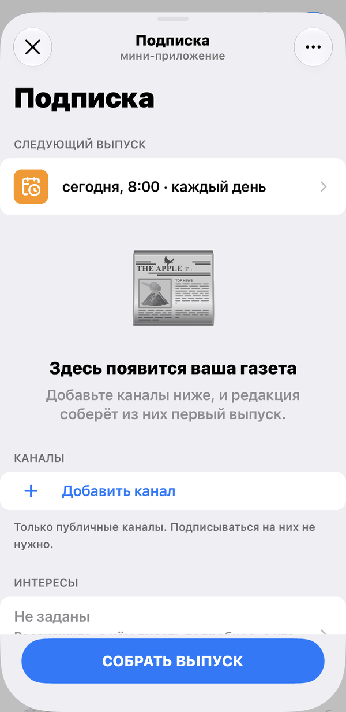
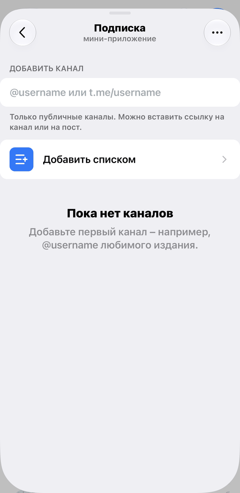
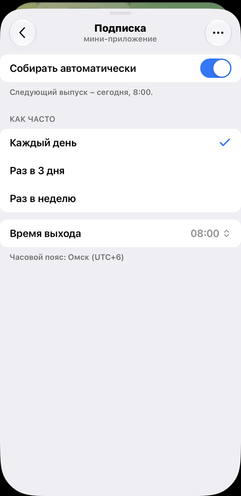
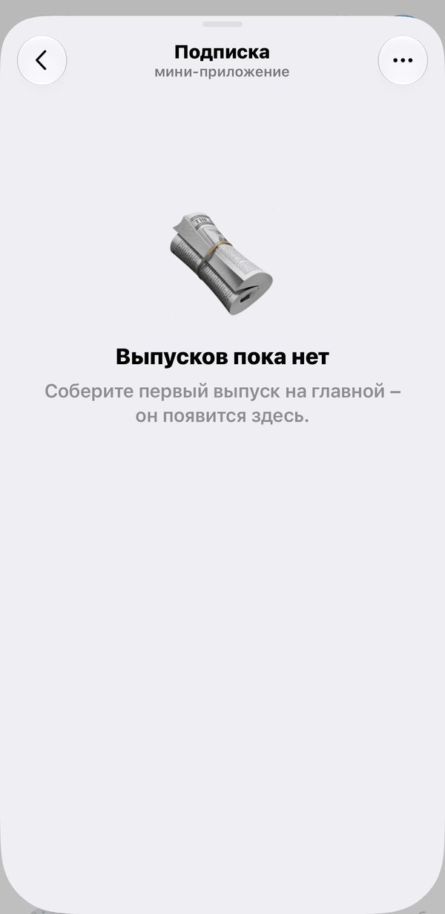
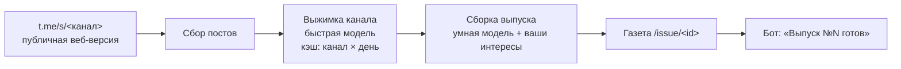

<h1 align="center">Подписка</h1>

<p align="center">
  Персональная газета из публичных Telegram-каналов – прямо в Telegram Mini App.
</p>

<p align="center">
  <a href="https://t.me/podpiska_news_bot">Демо: @podpiska_news_bot</a> ·
  <a href="#свой-экземпляр-за-10-минут">Свой экземпляр</a> ·
  <a href="LICENSE"></a>
</p>

<p align="center">
  
</p>

<table align="center">
  <tr>
    <td></td>
    <td></td>
    <td></td>
    <td></td>
  </tr>
</table>

<!--
Скриншоты, которых пока нет (добавить, когда будут):
- уведомление бота «Выпуск №N готов» с кнопкой
- заполненный хаб с последним выпуском и каналами
- тёмная тема (хаб и газета)
- карточка выпуска в чужом чате («Поделиться»)
-->

Вы добавляете каналы и одной фразой описываете, что вам интересно. По расписанию сервис
собирает посты, LLM отбирает и пересказывает главное, а выпуск свёрстан как настоящая газета.
У каждой заметки есть ссылки на исходные посты: нажали – открылась новость.

## Что умеет

- **Mini App вместо команд.** Каналы, интересы, расписание и архив – в нативном интерфейсе
  Telegram. Бот нужен только для входа и уведомлений.
- **Газета, а не лента.** Главная тема, рубрики, «В двух словах», цитата, курьёзы, афиша;
  светлая и тёмная тема, одна колонка на телефоне и разворот на десктопе.
- **Ссылки на источники.** Под каждой заметкой – подписи-ссылки на конкретные посты
  `t.me/<канал>/<id>`.
- **Расписание.** Каждый день, раз в 3 дня или раз в неделю, в выбранный час и часовой пояс;
  бот присылает «Выпуск №N готов».
- **Каналы пачкой.** Вставьте текст со ссылками и `@username` – Mini App найдёт каналы и
  покажет чеклист. Можно и переслать боту пост из канала.
- **Поделиться и PDF.** Карточка выпуска в любой чат, PDF присылает бот в личку.
- **Экономно.** Выжимка канала за день кэшируется и переиспользуется всеми читателями:
  расход на LLM растёт с числом каналов, а не пользователей.

## Как это работает



- LLM возвращает только структуру выпуска (JSON), вёрстку делает шаблон.
- LLM никогда не пишет URL: она оперирует id постов, ссылки собирает код. Заметка без ссылки на
  пост не публикуется.
- Стек: TypeScript, Next.js (App Router) на Vercel, grammY, Postgres (Neon) + Drizzle,
  Vercel AI SDK (по умолчанию Gemini), @telegram-apps/telegram-ui, vitest.

## Свой экземпляр за 10 минут

Понадобятся аккаунты GitHub, [Vercel](https://vercel.com) (Hobby бесплатный) и Telegram.
Базу Neon Vercel создаст сам. Ничего ставить на компьютер не нужно.

<a id="deploy-env"></a>

### 1. Бот в @BotFather

Откройте [@BotFather](https://t.me/BotFather) → `/newbot`, придумайте имя и username.
Скопируйте токен вида `123456789:AAH…` – это `TELEGRAM_BOT_TOKEN`.

**Проверка:** бот открывается по ссылке `t.me/<username>`, токен сохранён.

### 2. Ключ Gemini

Получите бесплатный ключ на [aistudio.google.com/apikey](https://aistudio.google.com/apikey) –
это `GOOGLE_GENERATIVE_AI_API_KEY`. Из России сайт открывается только через VPN, но VPN нужен
**только чтобы получить ключ**: сам сервер работает во Франкфурте (регион Vercel `fra1`).
Оплата в рублях без VPN – см. [ProxyAPI](#llm-и-деньги).

**Проверка:** ключ скопирован, обычно он начинается с `AIza`.

### 3. Ваш Telegram ID

Напишите [@userinfobot](https://t.me/userinfobot) – он ответит числовым id. Это
`OWNER_TELEGRAM_ID`: по умолчанию экземпляр частный и пускает только вас (см. [Доступ](#доступ)).

**Проверка:** у вас число, а не `@username`.

### 4. Deploy на Vercel

[](https://vercel.com/new/clone?repository-url=https%3A%2F%2Fgithub.com%2Fandreykolokhmatov%2Fpodpiska&project-name=podpiska&repository-name=podpiska&env=TELEGRAM_BOT_TOKEN,GOOGLE_GENERATIVE_AI_API_KEY,OWNER_TELEGRAM_ID&envDescription=%D0%A2%D0%BE%D0%BA%D0%B5%D0%BD%20%D0%B1%D0%BE%D1%82%D0%B0%20%D0%B8%D0%B7%20%40BotFather%2C%20%D0%BA%D0%BB%D1%8E%D1%87%20Gemini%20%D0%B8%D0%B7%20aistudio.google.com%2Fapikey%20%D0%B8%20%D0%B2%D0%B0%D1%88%20%D1%87%D0%B8%D1%81%D0%BB%D0%BE%D0%B2%D0%BE%D0%B9%20Telegram%20id%20%D0%B8%D0%B7%20%40userinfobot&envLink=https%3A%2F%2Fgithub.com%2Fandreykolokhmatov%2Fpodpiska%23deploy-env&stores=%5B%7B%22type%22%3A%22integration%22%2C%22integrationSlug%22%3A%22neon%22%2C%22productSlug%22%3A%22neon%22%2C%22protocol%22%3A%22storage%22%7D%5D)

1. Нажмите кнопку. Vercel склонирует репозиторий в ваш GitHub.
2. Создайте базу Neon, регион – **Frankfurt (`aws-eu-central-1`)**, рядом с сервером.
   Vercel сам положит `DATABASE_URL` и `DATABASE_URL_UNPOOLED`.
3. Вставьте три значения из шагов 1–3 и нажмите Deploy.

`APP_URL`, `TELEGRAM_WEBHOOK_SECRET` и `CRON_SECRET` вычисляются автоматически. Production-билд
сам применяет миграции базы и настраивает бота (webhook, `/start`, кнопку меню) – это шаг
`pnpm release` в `vercel.json`.

**Проверка:** в логе билда есть строки `migrations: … applied` и `bot configured`.

> После любого изменения переменных в Vercel (Settings → Environment Variables) сделайте
> **Redeploy** – иначе новые значения не подхватятся.

### 5. Main Mini App в @BotFather

Bot API не умеет включать её сам, это один клик руками:
@BotFather → `/mybots` → ваш бот → **Bot Settings → Configure Mini App → Enable Mini App** →
адрес деплоя (`https://<проект>.vercel.app`). Без этого не открываются ссылки «Поделиться».

**Проверка:** в профиле бота появилась кнопка открытия приложения.

### 6. /setup – всё зелёное

Откройте `https://<проект>.vercel.app/setup`, вставьте токен бота (он проверяется на сервере
и нигде не сохраняется). Страница проверит переменные, базу и миграции, бота (webhook, кнопку
меню, Main Mini App), ключ Gemini и расписание, а у красных пунктов подскажет, что сделать.
Кнопка «Настроить бота» повторно ставит webhook и меню; работает только на production-деплое.

**Проверка:** все пункты зелёные.

### 7. Будильник на cron-job.org

Выпуски по расписанию запускает внешний будильник раз в час. Зарегистрируйтесь на
[cron-job.org](https://cron-job.org) (бесплатно) → **Create cronjob**:

| Поле                      | Значение                                    |
| ------------------------- | ------------------------------------------- |
| URL                       | `https://<проект>.vercel.app/api/cron/tick` |
| Расписание                | каждый час, на 1-й минуте                   |
| Advanced → Request method | `POST`                                      |
| Advanced → Headers        | `Authorization: Bearer <CRON_SECRET>`       |

Готовые значения с секретом – в блоке «Расписание (cron-job.org)» на `/setup` (или
`pnpm selfhost:check --show-cron` локально).

**Проверка:** «Test run» в cron-job.org возвращает `200`.

### 8. Первый выпуск

Напишите боту `/start` → «Открыть Подписку» → добавьте пару каналов и интересы →
«Собрать выпуск».

**Проверка:** через пару минут выпуск открывается в Mini App, а под заметками есть ссылки на посты.

## LLM и деньги

- **Бесплатный ключ Gemini** (основной путь, `LLM_BASE_URL` пустой). Лимиты бесплатного тарифа
  Google меняет – актуальные смотрите в [AI Studio](https://aistudio.google.com/rate-limit) и
  [документации](https://ai.google.dev/gemini-api/docs/rate-limits). Наша оценка – до ~10
  каналов на бесплатном ключе; это оценка, а не замер. Если сборка падает с 429 – поставьте
  `LLM_CONCURRENCY=1`. Учтите: данные бесплатного тарифа Google может использовать для
  улучшения своих моделей ([условия](https://ai.google.dev/gemini-api/terms)).
- **Платный ключ Gemini** – тот же ключ с подключённым биллингом в Google Cloud, лимиты выше.
- **[ProxyAPI](https://proxyapi.ru)** – оплата в рублях, работает из России:
  `LLM_BASE_URL=https://api.proxyapi.ru/google/v1beta`, ключ ProxyAPI в
  `GOOGLE_GENERATIVE_AI_API_KEY`. ProxyAPI заранее резервирует баланс под максимальный ответ.
- **Модели.** По умолчанию выжимки – `gemini-3.5-flash-lite`, сборка выпуска –
  `gemini-3.5-flash`. Менять через `LLM_MODEL_FAST` / `LLM_MODEL_SMART`.
- **Хостинг.** Vercel Hobby и Neon Free хватает для личного использования. Hobby –
  некоммерческий тариф: если продаёте доступ к своему экземпляру, нужен Vercel Pro.

## Настройки

Обязательные переменные – в шагах выше. Остальные необязательны; полное описание – в
[`.env.example`](.env.example). После изменения – Redeploy.

| Переменная                    | По умолчанию            | Что делает                                                                      |
| ----------------------------- | ----------------------- | ------------------------------------------------------------------------------- |
| `PUBLIC`                      | пусто (частный)         | `1` – бот открыт для всех                                                       |
| `ALLOWED_TELEGRAM_IDS`        | пусто                   | id через запятую, кому ещё можно в частный экземпляр                            |
| `PRIVACY_CONTACT`             | пусто                   | контакт для удаления данных на `/privacy`: username, email или https-ссылка     |
| `APP_URL`                     | домен Vercel            | свой домен; https обязателен                                                    |
| `TELEGRAM_WEBHOOK_SECRET`     | из токена бота          | секрет webhook                                                                  |
| `CRON_SECRET`                 | из токена бота          | Bearer-секрет `/api/cron/tick`, ≥32 символов                                    |
| `LLM_BASE_URL`                | API Google              | Gemini-совместимый прокси, например ProxyAPI                                    |
| `LLM_MODEL_FAST`              | `gemini-3.5-flash-lite` | модель выжимок каналов                                                          |
| `LLM_MODEL_SMART`             | `gemini-3.5-flash`      | модель сборки выпуска                                                           |
| `LLM_CONCURRENCY`             | `3`                     | параллельных вызовов LLM, 1..10; `1` при 429                                    |
| `MAX_CHANNELS_PER_USER`       | `50`                    | лимит каналов на пользователя                                                   |
| `MAX_BUILDS_PER_DAY_GLOBAL`   | `30`                    | сборок в день на всех, ручных и по расписанию (плюс 3 ручных в день на каждого) |
| `MAX_CHANNEL_LOOKUPS_PER_DAY` | `300`                   | проверок новых каналов в день на пользователя                                   |
| `TELEGRAM_BOT_USERNAME`       | пусто                   | плашка «Соберите свою газету → @bot» в конце выпуска                            |
| `PODPISKA_CREDIT`             | включено                | `off` скрывает строку «Сделано на Подписке»                                     |
| `TELEGRAM_DEV_BOT_TOKEN`      | пусто                   | второй (dev) бот, открывающий тот же сайт                                       |
| `SKIP_DB_MIGRATE`             | пусто                   | `1` – пропустить шаг release при деплое: ни миграций, ни настройки бота         |
| `CHROME_EXECUTABLE_PATH`      | пусто                   | только локально: Chrome для рендера PDF                                         |

## Доступ

- **Частный по умолчанию.** Пускает только `OWNER_TELEGRAM_ID`. У владельца нет дневного
  лимита ручных сборок.
- **Для семьи и друзей.** Добавьте их id в `ALLOWED_TELEGRAM_IDS` через запятую → Redeploy.
- **Для всех.** `PUBLIC=1` → Redeploy; тогда `OWNER_TELEGRAM_ID` не обязателен. Подумайте о лимитах:
  LLM оплачиваете вы.

## Обновление

Кнопка Deploy **клонирует** репозиторий, а не форкает: кнопки «Sync fork» у копии нет.
Подтянуть свежую версию:

```sh
git clone https://github.com/<вы>/podpiska && cd podpiska
git remote add upstream https://github.com/andreykolokhmatov/podpiska.git
git pull --no-rebase --allow-unrelated-histories upstream main   # первый раз
git push
```

В следующие разы – `git pull --no-rebase upstream main` и `git push`. Если git сообщил о
конфликтах, возьмите версию upstream: `git checkout --theirs <файл>`, затем `git add <файл>`,
`git commit` и `git push`.

Push в `main` запускает деплой, миграции применятся сами.

Хотите обновляться в один клик – вместо кнопки сделайте **Fork** на GitHub, затем в Vercel
**Add New → Project → Import** этого форка, подключите Neon (Storage) и задайте те же три
переменные. Дальше обновление – «Sync fork» на GitHub.

## Локальная разработка

Нужны Node.js 22.17+ или 24+ и pnpm. Ставьте pnpm через `npm i -g pnpm`: corepack не входит в
Node 25+, а на Windows `corepack enable` часто падает с EPERM.

```sh
git clone https://github.com/andreykolokhmatov/podpiska && cd podpiska
pnpm install
cp .env.example .env        # заполните, каждая переменная там описана
pnpm db:migrate             # таблицы в вашей базе
pnpm dev
```

| Команда / адрес                                         | Что это                                            |
| ------------------------------------------------------- | -------------------------------------------------- |
| `http://localhost:3000/?mock=1`                         | Mini App на моках, без Telegram и бэкенда          |
| `http://localhost:3000/issue/preview?fixture=reference` | газета без базы (только в dev)                     |
| `pnpm bot:dev --expect-bot <dev_бот>`                   | бот в режиме polling, для dev-бота                 |
| `pnpm selfhost:check`                                   | тот же чеклист, что `/setup`, по локальному `.env` |
| `pnpm selfhost:check --apply --expect-bot <бот>`        | настроить бота и проверить                         |
| `pnpm selfhost:check --show-cron`                       | настройки задания cron-job.org с секретом          |
| `pnpm test`                                             | vitest, без реальных LLM и сети                    |
| `pnpm typecheck`, `pnpm lint`                           | типы и линтер                                      |
| `pnpm issue --user <telegram_id> --days 1`              | собрать выпуск из консоли (тратит LLM)             |

Mini App внутри Telegram открывается только по https: тестируйте на деплое или через туннель
к `pnpm dev` ([cloudflared](https://developers.cloudflare.com/cloudflare-one/connections/connect-networks/do-more-with-tunnels/trycloudflare/),
[ngrok](https://ngrok.com)) и укажите его адрес в `APP_URL`.

**Миграции – expand/contract.** Миграция применяется до того, как новый код начнёт отвечать,
поэтому старый код должен работать с новой схемой: никаких `DROP` и `RENAME` в одном релизе с
кодом. Сначала добавить новое, в следующем релизе – убрать старое.

## С ИИ-агентом

Claude Code или Codex хорошо помогают с локальной разработкой: прочитать код, запустить
`pnpm selfhost:check` и разобрать его вывод, найти причину падения в логах. Но клики в Vercel,
@BotFather, AI Studio и cron-job.org делает человек: агенту не нужен доступ к вашим аккаунтам
и секретам.

## FAQ

**Можно ли использовать подписку Claude / ChatGPT / Codex вместо ключа Gemini?**
Нет. Подписки – это доступ к чату, а не API для серверов, и их условия запрещают такое
использование. Нужен API-ключ.

**Можно ли без Vercel?**
Да, если есть Node 22.17+, Postgres и публичный https-адрес: `pnpm build && pnpm start`,
`APP_URL` обязателен, миграции – `pnpm db:migrate`, бот – `pnpm bot:setup --expect-bot <бот>`.
PDF рендерит `@sparticuz/chromium`, он работает только на Linux serverless; в другом
окружении укажите `CHROME_EXECUTABLE_PATH`.

**Почему не GitHub Actions cron и не Vercel Cron?**
Vercel Cron на Hobby срабатывает раз в день – мало для почасового расписания. GitHub Actions
cron теряет запуски, отключается после 60 дней без активности в репозитории и не работает в
форках. `.github/workflows/tick.yml` оставлен как резерв: задайте в репозитории секреты
`CRON_SECRET` и `APP_URL`.

**Работает на localhost?**
Сайт и газета – да. Mini App в Telegram и webhook бота требуют https (см. туннель выше);
для бота локально есть `pnpm bot:dev`.

**Приватные каналы?**
Не поддерживаются: посты читаются из публичной веб-версии `t.me/s/<канал>`.

**Хватит ли места в Neon Free?**
Для личного использования – да, но посты пока не удаляются автоматически, база растёт со
временем. Очистка старых постов – в планах.

## Лицензия

[MIT](LICENSE). В конце каждой газеты по умолчанию есть небольшая строка «Сделано на
Подписке» со ссылкой на этот репозиторий. Её можно скрыть (`PODPISKA_CREDIT=off`), но если
оставите – будем благодарны: так о проекте узнают другие.
